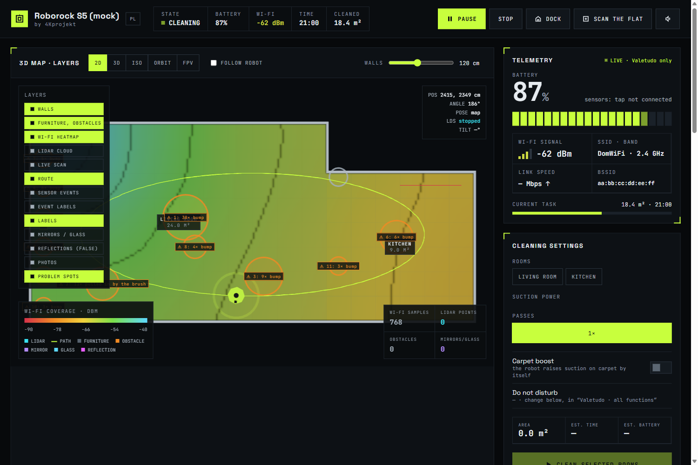
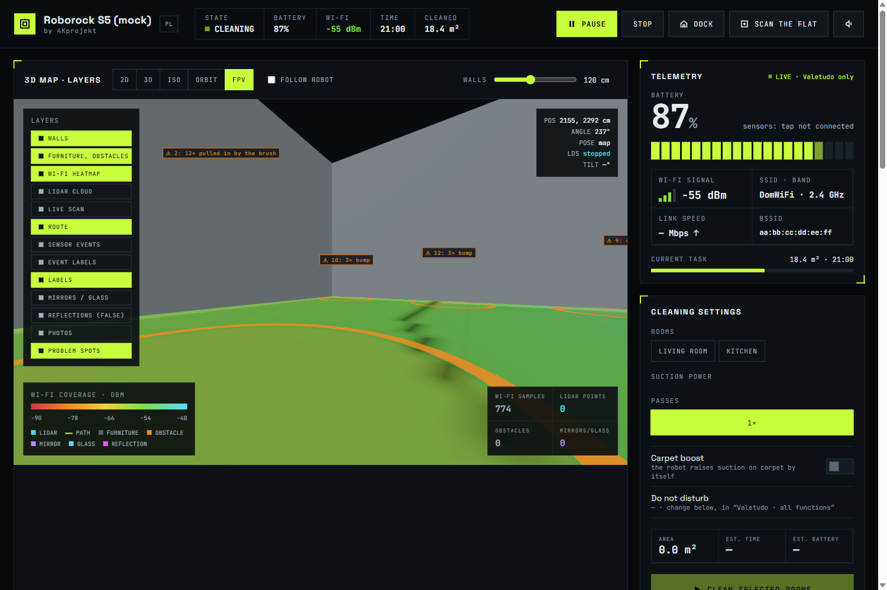
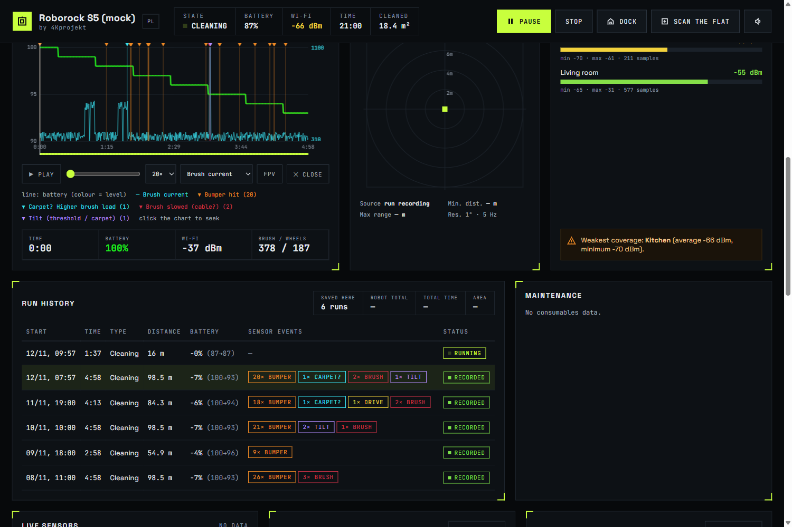
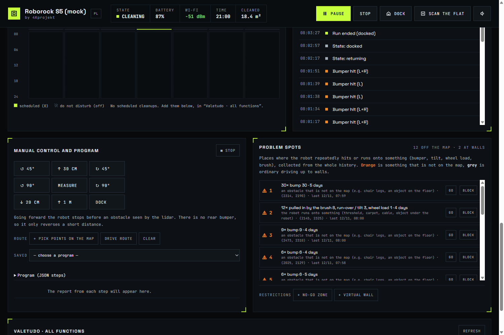

# roborock_valetudo

A local control panel and AI (MCP) bridge for a Roborock vacuum running [Valetudo](https://valetudo.cloud):
2D/3D map, live raw lidar, MCU sensor data (bumper, cliff, wheel and brush current), cleaning history,
Wi-Fi heatmap, "problem spots" where the robot keeps bumping into things, no-go zones and scripted routes.



| First-person view (FPV) | Run history and replay |
| :---: | :---: |
|  |  |



Screenshots show the built-in fake robot (`--robot mock`) with generated demo data, not a real flat.

> [!WARNING]
> **This whole project was written by AI** (Claude, with a human giving directions and testing).
> It has not been reviewed line by line by an experienced developer. Read the code before you run it,
> especially the part that modifies the robot. **Use at your own risk. The authors take no responsibility
> for a damaged or bricked robot, lost data, or anything else.** See the [LICENSE](LICENSE) (MIT, no warranty).

> [!NOTE]
> **Tested only on a Roborock S5 (S50/S55 family) with firmware 2034 and Valetudo 2026.10.0.**
> Other models (S5 Max, S6, S7, ...) have different firmware, processes and lidar formats. The Valetudo part
> may work, the lidar tap will most likely need changes.

The panel is in English, or Polish when your browser language is Polish. The `PL` / `EN` button in the header
switches it. Translations live in `static/i18n.js`: a Polish to English dictionary applied to the page.
Strings it misses are listed in `window.i18nMissing` in the browser console. MCP tool descriptions are still Polish.

## What you need

- A Roborock S5 rooted with Valetudo, reachable on your LAN, with SSH access as `root` using a key.
- A PC with Python 3 (standard library only, no `pip install`), `ssh` on the PATH, and a browser.
- Optional: [Zig](https://ziglang.org) (`python -m pip install ziglang`) to build the lidar tap.

## Step 1: Root the robot and install Valetudo

Follow the official guide: <https://valetudo.cloud/pages/installation/roborock.html>.
Do not skip the full factory reset. Keep your SSH key: you need it in step 3.

Check: `http://<robot-ip>` opens the Valetudo UI.

## Configuration

Copy `.env.example` to `.env` and set at least `ROBOROCK_URL`. `.env` is ignored by git.
Environment variables and command-line flags override `.env`.

| Setting | Required | Default | What it is |
| :--- | :--- | :--- | :--- |
| `ROBOROCK_URL` / `--robot` | **yes** | none | Valetudo address, e.g. `http://192.168.1.50`, or `mock` |
| `ROBOROCK_SSH_KEY` / `--ssh-key` | for step 3 | `~/.ssh/roborock` | SSH private key for `root` on the robot |
| `ROBOROCK_TAP` / `--no-tap` | no | `1` | `0` = do not connect over SSH (no live lidar/sensors) |
| `ROBOROCK_PANEL_HOST` / `--host` | no | `127.0.0.1` | Panel listen address. The panel has **no login**, do not expose it. |
| `ROBOROCK_PANEL_PORT` / `--port` | no | `8780` | Panel port |
| `ROBOROCK_DATA` | no | `data/` | Where sessions, events and Wi-Fi samples are stored. Real environment variable only, not read from `.env`. Use a separate folder for `mock`. |
| `ROBOROCK_PANEL` | no | `http://127.0.0.1:8780` | Used by `mcp_server.py` to reach the panel (set in the MCP client config) |

Fixed values you may need to change in code for another model or firmware:

- `server.py` `tap_reader`: SSH user `root`, relay path `/mnt/data/lidartap_relay`.
- `lds.py`: `LDS_ANGLE_OFFSET_DEG = 10`, `POSE_LAG_MS = 200` (lidar mounting angle and pose delay; if walls
  in the live scan look rotated or smeared while turning, tune these).
- `sensors.py`: thresholds for carpet, brush jam, drive load and tilt are heuristics measured on one S5.
- `static/scene.js`: `HEADING_OFFSET_DEG = -90`.

## Step 2: Run the panel (no changes to the robot)

```sh
cp .env.example .env     # then edit ROBOROCK_URL (and ROBOROCK_TAP=0 until step 3 is done)
python server.py
# no robot at hand: python server.py --robot mock
```

Open <http://127.0.0.1:8780>. Map, status, cleaning, rooms, zones, timers, consumables and all other
Valetudo functions work at this point. Live lidar and sensors need step 3.

The panel listens only on `127.0.0.1`. It does not support Valetudo HTTP Basic Auth.

## Step 3 (optional): Lidar and sensor tap on the robot

Valetudo does not expose raw lidar or sensor data, so a small library copies it inside the robot:

- `tap/lidartap.so` is loaded into Roborock's `rr_loader` with `LD_PRELOAD`. It hooks `read_lds_mmap_buf()`
  (lidar) and `get_package()` (MCU) and **copies** the bytes over UDP to `127.0.0.1:9876` on the robot.
  It does not change or block anything.
- `tap/lidartap_relay` prints those packets to stdout and adds the SLAM pose (10 Hz).
  `server.py` starts it over SSH and decodes the data.

1. Build (or skip if you trust prebuilt binaries you made yourself):
   ```sh
   sh tap/build.sh          # Zig, target arm-linux-gnueabihf.2.19 (Allwinner R16, glibc 2.19)
   ```
2. Copy to the robot:
   ```sh
   scp -i <key> tap/lidartap.so tap/lidartap_relay root@<robot-ip>:/mnt/data/
   ssh -i <key> root@<robot-ip> chmod +x /mnt/data/lidartap_relay
   ```
3. Back up the watchdog config, then edit one line:
   ```sh
   ssh -i <key> root@<robot-ip> cp /opt/rockrobo/watchdog/ProcessList.conf /opt/rockrobo/watchdog/ProcessList.conf.orig
   ```
   In `/opt/rockrobo/watchdog/ProcessList.conf` change the `rr_loader` line to:
   ```
   rr_loader,LD_PRELOAD=/mnt/data/lidartap.so setsid rr_loader -d&,1,5,1
   ```
   Compare with the original line first: your firmware may differ.
4. Reboot the robot. In `.env` set `ROBOROCK_SSH_KEY=<key>` and `ROBOROCK_TAP=1`, then restart `python server.py`.
   Check: the lidar scan appears on the map and "lidar age" in the status is under a second.

**Undo:**
```sh
ssh -i <key> root@<robot-ip> 'cp /opt/rockrobo/watchdog/ProcessList.conf.orig /opt/rockrobo/watchdog/ProcessList.conf && sync && reboot'
```

## Step 4 (optional): Connect an AI agent (MCP)

`mcp_server.py` is a stdio MCP server (standard library only) with 26 tools: status, start/stop, rooms, zones,
go-to, routes, step-by-step programs, manual driving, problem spots, no-go zones, timers and raw Valetudo API.
It talks to the running panel (`ROBOROCK_PANEL`, default `http://127.0.0.1:8780`).

```sh
claude mcp add roborock -s user -- python /path/to/mcp_server.py
python mcp_server.py --test     # self-check
```

The agent can move a real robot. Risky Valetudo calls (map reset, Wi-Fi change, persistent map, quirks,
voice pack) need explicit confirmation. Updater and Valetudo settings are blocked.

### MCP examples

Just ask in plain language. The agent picks the tools. Examples that were used on a real S5:

| You say | What the agent does |
| :--- | :--- |
| "Why did the vacuum stop?" | `robot_status`, `events`, `sessions`: battery curve, errors, last position |
| "Start cleaning, but watch out for cables" | `hotspots` to find where it got stuck before, asks you, then `restrictions add_zone` and `robot_control start` |
| "Check the cleaning" | `sessions` + `events`: area covered, where it bumped, why it returned early |
| "Show me the problem areas and suggest zones to block" | `hotspots`: spots with many bumps, brush jams or cliff triggers, each with a ready no-go zone |
| "Clean only the kitchen twice" | `list_rooms`, `clean_rooms {ids:["3"], iterations:2}` |
| "Drive 50 cm forward, turn left and look around" | `drive` or `run_program` with `forward`, `turn`, `look` steps |
| "Run program serwis_mapy" | `run_program {name:"serwis_mapy"}`, then `job_status` for per-step results |

A step program (`run_program` with `steps`, or a JSON file in `programs/`):

```json
[
  {"goto": [2429, 3004]},
  {"look": true},
  {"turn": 90},
  {"look": true},
  {"clean_zone": [2300, 2900, 2500, 3100]},
  {"wait_done": true},
  {"home": true}
]
```

`run_program {help:true}` lists all step types. `job_status` returns, per step: result, distance left,
pose, and sensor events (bumper, brush jam, ...) that happened during that step.

## Let Claude (or another AI agent) do the setup

With [Claude Code](https://claude.com/claude-code) running in this folder, you can hand over almost everything
after a factory reset. Claude runs the commands, reads the output and fixes problems. **You** do the physical
steps (buttons, Wi-Fi switching) and approve each download, robot change and reboot.

Read the warning at the top first. Flashing firmware can brick the robot.

1. **Factory reset the robot** (you): on the S5 hold Dock, press Reset with a pin, keep holding Dock about 5 s
   until the voice prompt. A plain reset is not enough: the firmware upload then silently fails.
2. **Get the rooted firmware** (you): build it on [Dustbuilder](https://builder.dontvacuum.me) for your model
   with your SSH public key, as the [Valetudo guide](https://valetudo.cloud/pages/installation/roborock.html) says.
   Claude can generate the key pair for you first (step a below).
3. **Connect the PC to the robot's Wi-Fi** (`roborock-vacuum-...`, robot at `192.168.8.1`), unplug LAN cable.
4. **Give Claude a prompt**, for example:

   ```text
   Read README.md. My Roborock S5 was just factory reset and my PC is on its Wi-Fi.
   a) If there is no SSH key yet, create ~/.ssh/roborock (ed25519) and show me the public key for Dustbuilder.
   b) Install the firmware file <path to .pkg> with valetudo-helper-miioota (install-firmware).
      Temporarily allow it through the firewall and tell me exactly what you changed, then revert it.
   c) When Valetudo answers on 192.168.8.1, set Wi-Fi to my home network. I will type the password myself
      in the Valetudo UI, do not ask me for it.
   d) Find the robot's new IP on my LAN, write .env from .env.example, start server.py and check /local/state.
   e) Build the tap with tap/build.sh, copy it to /mnt/data, back up ProcessList.conf, add the LD_PRELOAD line,
      reboot, and confirm the live lidar works. Ask me before each change on the robot.
   f) Register mcp_server.py as MCP server "roborock" and run its self-check.
   ```

5. **After the first run**, ask for a map scan:
   `Run explore, then show hotspots and suggest no-go zones. Do not apply zones without asking me.`

Things Claude should not do for you: enter your Wi-Fi password or any other password, register accounts,
or accept terms on websites. Type those yourself.

## How data is used

- **Everything stays on your machine.** The panel talks only to the robot on your LAN. No telemetry,
  no accounts, no cloud. Valetudo itself is cloud-free.
- Stored locally in `data/` (excluded from git):
  - `sessions/<id>.jsonl`: one frame every 0.5 s per run (position, battery, Wi-Fi signal, sensors, lidar scan) and events.
  - `events.jsonl`: bumper, cliff, brush, door and error events. Used for problem spots and history.
  - `wifi_samples.jsonl`: signal strength by position, for the Wi-Fi heatmap.
  - `lidar_<date>.bin`: raw lidar bytes (about 20 to 40 MB per day of cleaning). Delete freely.
  - `known_hosts`: the robot's SSH host key.
- The 3D view loads three.js from the jsDelivr CDN, so your browser contacts that CDN.
- **If you use the MCP server with a cloud AI** (Claude, ChatGPT, ...), the tool results (map coordinates,
  room names, status, events, Wi-Fi names) are sent to that AI provider. Use a local model if that matters to you.
- Never commit your SSH private key. `.gitignore` excludes `.env`, `roborock`, `*.key` and `data/`.

## Files

| File | Purpose |
| :--- | :--- |
| `server.py` | Panel web server, Valetudo proxy with write rules, recorder, tap reader, `/local/*` endpoints |
| `mcp_server.py` | MCP server for AI agents |
| `lds.py`, `sensors.py`, `analysis.py` | Lidar and MCU decoders, map analysis, problem spots (each has a self-check: `python <file>`) |
| `mock_robot.py` | Fake robot for `--robot mock` |
| `static/` | Panel UI (three.js scene, history charts) |
| `programs/` | Saved step programs (JSON) |
| `tap/` | C sources for the on-robot tap and build script |
| `README.pl.md` | Original Polish notes with calibration details |

## License

[MIT](LICENSE). Provided "as is", without warranty of any kind. Not affiliated with Roborock or Valetudo.
